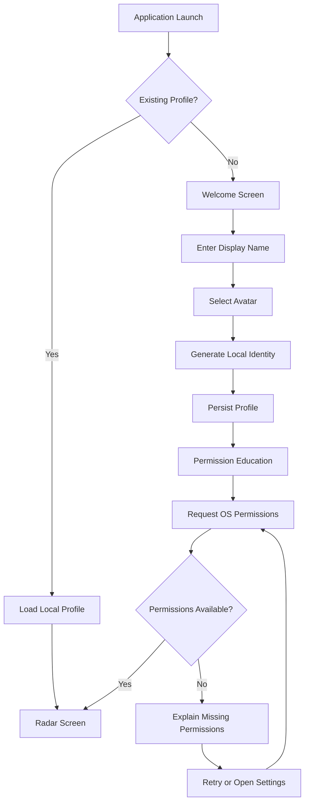
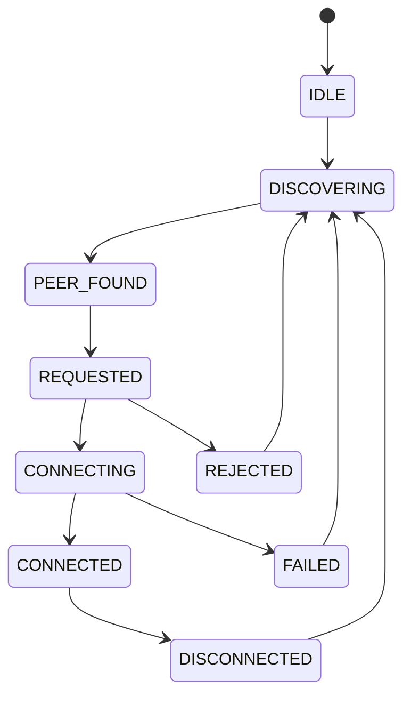
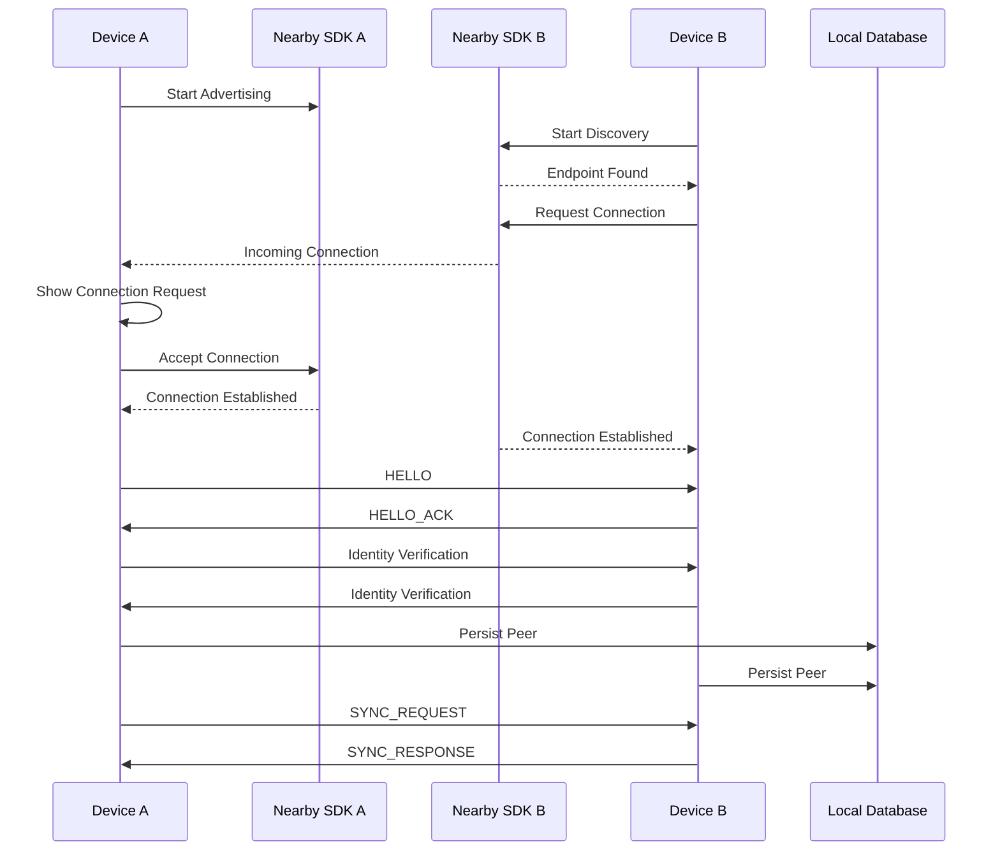
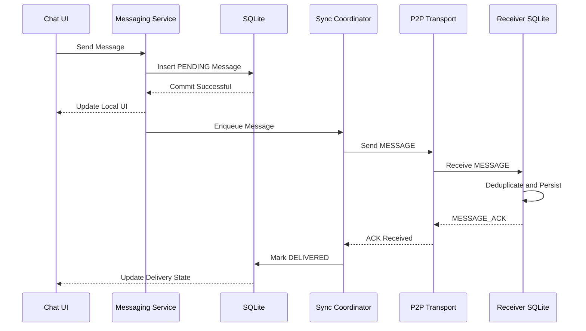
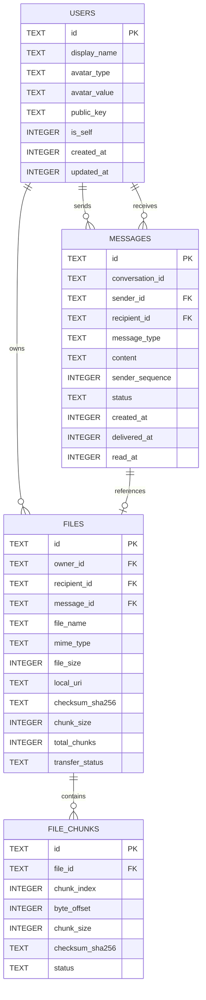
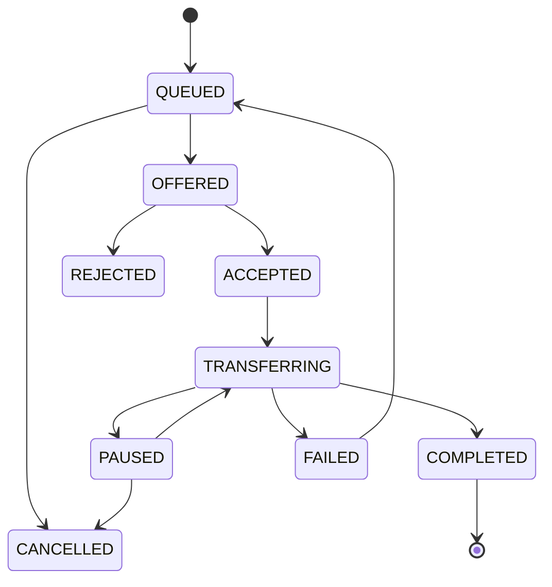
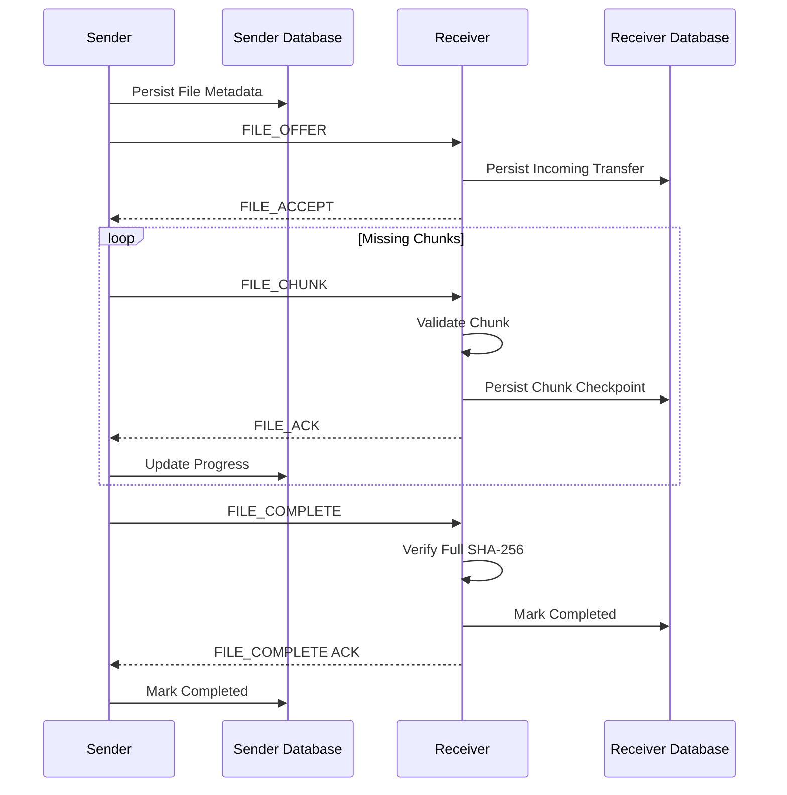
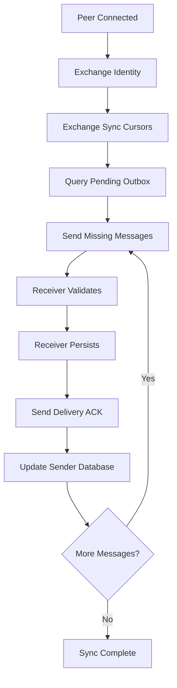
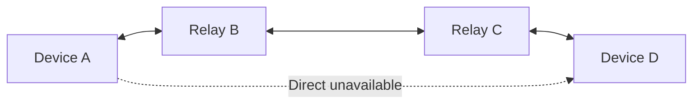

# Pulse — Product Requirements Document (PRD)

**Project:** Pulse  
**Document Type:** Product Requirements + Technical Design Specification  
**Version:** 1.0  
**Status:** Engineering Specification  
**Platform:** Android-first (iOS planned)  
**Application Type:** Offline-first Peer-to-Peer Messaging & File Sharing  
**Framework:** React Native + TypeScript  
**Native Layer:** Kotlin (Android), Swift (future iOS)  
**Networking:** Google Nearby Connections API  
**Database:** SQLite  
**State Management:** Zustand  
**Animations:** React Native Reanimated + Gesture Handler  
**Target:** Google Play Store

---

# 1. Product Overview

## 1.1 Product Vision

Pulse is a completely offline, peer-to-peer messaging and file-sharing application that enables nearby devices to communicate without internet connectivity, SIM cards, cloud infrastructure, phone numbers, or centralized servers.

Pulse uses the devices' local wireless capabilities to discover nearby users, establish direct connections, exchange messages, and transfer files.

The application should provide a communication experience similar to conventional messaging applications while maintaining a fundamentally different architecture: every device operates independently and stores its own data locally.

### Core Product Promise

**No internet. No accounts. No servers. Just nearby devices communicating directly.**

## 1.2 Problem Statement

Conventional messaging and file-sharing applications depend on centralized infrastructure, internet connectivity, or external identity systems.

This creates limitations in environments such as:

- Remote locations with poor or no internet connectivity.
- Educational institutions with unreliable networks.
- Travelling and outdoor exploration.
- Events, conferences, and crowded public environments.
- Emergency situations where conventional communication infrastructure is unavailable.
- Situations where users prefer not to register with a centralized service.

Pulse addresses these scenarios by creating a local communication network between nearby devices.

## 1.3 Product Objectives

1. Enable users to create an identity without registration or internet access.
2. Discover nearby Pulse users using local wireless technologies.
3. Establish direct peer-to-peer communication.
4. Support reliable one-to-one offline messaging.
5. Support large file transfers with interruption recovery.
6. Persist all important application data locally.
7. Synchronize pending messages when devices reconnect.
8. Minimize battery consumption and unnecessary background activity.
9. Maintain a modular architecture that supports future platforms and transport implementations.

## 1.4 Non-Goals

The initial release will not include:

- Cloud messaging infrastructure.
- Phone-number authentication.
- Email authentication.
- OTP verification.
- Cloud message backups.
- Internet-based messaging.
- Group messaging.
- Voice or video calls.
- Public social profiles.
- Multi-hop mesh networking in the MVP.
- Cross-application communication with arbitrary P2P applications.

---

# 2. Target Users

| Persona                 | Problem                                | Pulse Value                            |
| ----------------------- | -------------------------------------- | -------------------------------------- |
| Students                | Internet unavailable or unreliable     | Share notes and communicate locally    |
| Travellers              | Connectivity limitations               | Communicate with nearby people         |
| Event attendees         | Difficult to exchange files            | Direct device-to-device sharing        |
| Outdoor enthusiasts     | Remote locations                       | Local communication                    |
| Privacy-conscious users | Dependence on centralized services     | No mandatory accounts or cloud servers |
| Developers              | Interest in distributed mobile systems | Explore offline-first P2P networking   |

---

# 3. Product Principles

All product and engineering decisions must follow these principles.

### 3.1 Local-First

The local database is the source of truth for the application UI.

The application must remain usable when no peer is connected.

### 3.2 Offline by Default

The application must not require internet connectivity for onboarding, discovery, messaging, or file sharing.

### 3.3 Explicit Connection

Users must explicitly accept incoming connection requests before establishing a communication session.

### 3.4 Reliable Delivery

Messages must not be considered delivered merely because a network API successfully transmitted a payload.

The receiving device must persist the message and acknowledge successful persistence.

### 3.5 Resource Efficiency

Networking, file processing, database operations, and animations must not unnecessarily block the React Native JavaScript thread.

### 3.6 Privacy

Users should have control over discoverability, connection requests, identity information, and received files.

### 3.7 Extensibility

The application protocol must remain independent of the underlying networking transport.

Nearby Connections will be the initial transport, but future transports should not require rewriting messaging or database logic.

---

# 4. Technical Stack

| Layer              | Technology                          | Responsibility                    |
| ------------------ | ----------------------------------- | --------------------------------- |
| Mobile framework   | React Native CLI                    | Application foundation            |
| Language           | TypeScript                          | Application logic and contracts   |
| Android native     | Kotlin                              | Native networking integration     |
| iOS native         | Swift                               | Future platform integration       |
| Native integration | Turbo Native Modules                | React Native-native communication |
| P2P networking     | Google Nearby Connections           | Discovery and transport           |
| Database           | SQLite                              | Local persistence                 |
| SQLite integration | op-sqlite or equivalent             | Database access                   |
| State management   | Zustand                             | Transient application state       |
| Animations         | Reanimated                          | Radar and UI animations           |
| Gestures           | Gesture Handler                     | Native gesture interactions       |
| Navigation         | React Navigation                    | Screen navigation                 |
| File storage       | Native filesystem                   | Binary file management            |
| Validation         | Zod                                 | Runtime protocol validation       |
| Testing            | Jest + React Native Testing Library | Application testing               |
| Native testing     | Android instrumentation tests       | Kotlin and SDK testing            |

## 4.1 Important Networking Decision

Google Nearby Connections provides an abstraction over nearby-device discovery, connection establishment, and payload exchange.

It manages underlying transport selection and may use Bluetooth, BLE, Wi-Fi, and other available technologies.

Pulse must not assume that every connection follows a specific BLE-to-Wi-Fi Direct upgrade sequence or that the SDK exposes a usable Wi-Fi Direct IP address.

**MVP networking architecture:**

- Nearby Connections handles peer discovery.
- Nearby Connections handles connection establishment.
- Nearby Connections handles bidirectional communication.
- Nearby Connections handles file and byte payloads.
- Pulse implements its own application-level protocol above Nearby.

A separate TCP/WebSocket server is not required for the MVP.

If a future transport requires TCP or WebSockets, it must implement the same application transport interface.

---

# 5. Application Architecture

## 5.1 High-Level Architecture

The application follows a layered, local-first architecture.

```text
┌──────────────────────────────────────────────┐
│              PRESENTATION LAYER              │
│                                              │
│  Onboarding | Radar | Chats | Files | Profile│
│                                              │
│       React Native + TypeScript              │
└──────────────────────┬───────────────────────┘
                       │
                       ▼
┌──────────────────────────────────────────────┐
│              APPLICATION LAYER               │
│                                              │
│  DiscoveryService                            │
│  ConnectionService                           │
│  MessagingService                            │
│  FileTransferService                         │
│  SyncCoordinator                             │
│  IdentityService                             │
└──────────────────────┬───────────────────────┘
                       │
          ┌────────────┴────────────┐
          ▼                         ▼
┌─────────────────────┐   ┌─────────────────────┐
│   PERSISTENCE       │   │  NETWORK ABSTRACTION│
│                     │   │                     │
│ SQLite              │   │ P2PTransport        │
│ Repositories        │   │ ProtocolHandler     │
│ Database Queries    │   │ EventDispatcher     │
│ Local File Storage  │   │                     │
└─────────────────────┘   └──────────┬──────────┘
                                     │
                                     ▼
                          ┌─────────────────────┐
                          │   NATIVE ADAPTER    │
                          │                     │
                          │ Turbo Native Module │
                          │ Kotlin              │
                          │ Nearby Connections │
                          └─────────────────────┘
```

## 5.2 Architectural Rules

1. UI components must never call native networking methods directly.
2. UI components must not directly execute networking synchronization logic.
3. All durable messages must be persisted in SQLite.
4. Network events must be validated before entering application services.
5. Network transport must remain independent of message processing.
6. Zustand must not become a second persistent database.
7. File binary data must not be stored in Zustand.
8. File binary data must not be repeatedly serialized through JavaScript.
9. Native networking callbacks must not perform expensive work on the Android main thread.
10. Database repositories must own all persistence operations.

## 5.3 Recommended Source Structure

```text
pulse/
│
├── android/
│   └── app/src/main/java/com/pulse/
│       ├── networking/
│       │   ├── PulseNetworkingModule.kt
│       │   ├── PulseNetworkingPackage.kt
│       │   ├── NearbyConnectionManager.kt
│       │   ├── NearbyPayloadManager.kt
│       │   ├── NearbyCallbacks.kt
│       │   └── NativeEventDispatcher.kt
│       │
│       ├── services/
│       │   └── PulseForegroundService.kt
│       │
│       └── storage/
│           └── NativeFileStorage.kt
│
├── src/
│   ├── app/
│   │   ├── navigation/
│   │   ├── providers/
│   │   └── bootstrap/
│   │
│   ├── features/
│   │   ├── onboarding/
│   │   ├── discovery/
│   │   ├── connections/
│   │   ├── chat/
│   │   ├── files/
│   │   └── profile/
│   │
│   ├── core/
│   │   ├── database/
│   │   │   ├── migrations/
│   │   │   ├── repositories/
│   │   │   ├── queries/
│   │   │   └── DatabaseManager.ts
│   │   │
│   │   ├── networking/
│   │   │   ├── transport/
│   │   │   ├── protocol/
│   │   │   ├── schemas/
│   │   │   └── eventHandlers/
│   │   │
│   │   ├── sync/
│   │   │   ├── SyncCoordinator.ts
│   │   │   ├── OutboxProcessor.ts
│   │   │   ├── InboxProcessor.ts
│   │   │   └── AcknowledgementHandler.ts
│   │   │
│   │   ├── storage/
│   │   ├── security/
│   │   ├── state/
│   │   ├── types/
│   │   └── utils/
│   │
│   └── components/
│
├── docs/
│   ├── PRD.md
│   ├── ARCHITECTURE.md
│   ├── DATABASE.md
│   ├── NETWORK_PROTOCOL.md
│   ├── NATIVE_INTEGRATION.md
│   └── DEVELOPMENT_ROADMAP.md
│
└── README.md
```

---

# 6. User Experience and Navigation

## 6.1 Application Navigation

The primary application navigation contains:

1. Radar
2. Chats
3. Transfers
4. Profile

The radar screen is the primary discovery experience.

Chats contains existing conversations, including disconnected peers.

Transfers contains outgoing and incoming file transfers.

Profile contains local identity, discoverability, and application settings.

## 6.2 Onboarding Flow

### User Story

As a new user, I want to create a local identity without providing personal registration information.

### Flow



### Functional Requirements

- No login screen.
- No email or phone-number input.
- No OTP.
- No internet request.
- Profile creation must work offline.
- Profile must survive application restart.
- Display name must be between 1 and 30 characters.
- Users may choose an emoji or local image as an avatar.
- Generate a UUID for the local identity.
- Generate a cryptographic identity key pair.
- Store private key material in Android Keystore or an appropriate secure native storage mechanism.

### Profile Data

```typescript
interface LocalProfile {
  id: string;
  displayName: string;
  avatarType: "emoji" | "image";
  avatarValue: string | null;
  publicKey: string;
  createdAt: number;
  updatedAt: number;
}
```

### Acceptance Criteria

- [ ] User can complete onboarding without internet.
- [ ] User can restart the application without recreating the profile.
- [ ] Invalid display names are rejected.
- [ ] Permission denial is handled gracefully.
- [ ] The application never requires account registration.
- [ ] Private identity material is not exposed to ordinary JavaScript application state.

---

# 7. Discovery — Radar Screen

## 7.1 Product Requirement

The radar screen displays nearby discoverable Pulse users through an animated interface.

It is the primary visual identity of Pulse.

### User Story

As a user, I want to see nearby Pulse users and initiate a connection request.

## 7.2 UX Requirements

- Full-screen dark interface.
- Concentric animated radar rings.
- Central representation of the current user.
- Nearby peers displayed as avatar bubbles.
- Smooth peer appearance and disappearance.
- Connection status indicators.
- Tap-to-connect interaction.
- Empty state when no peers are available.
- Discovery start/stop control.
- Discovery state indicator.

## 7.3 Peer Discovery

When discovery starts:

1. Native networking manager initializes discovery.
2. Nearby Connections searches for compatible advertising endpoints.
3. Native callbacks report discovered endpoints.
4. The native module emits lightweight events.
5. JavaScript validates peer metadata.
6. DiscoveryService updates the peer registry.
7. Zustand updates the visible peer list.
8. Radar renders the peers.

### Peer Model

```typescript
type PeerConnectionState =
  | "DISCOVERED"
  | "CONNECTING"
  | "CONNECTED"
  | "DISCONNECTED";

interface DiscoveredPeer {
  endpointId: string;
  displayName: string;
  avatarType: "emoji" | "image";
  avatarValue?: string;
  connectionState: PeerConnectionState;
  discoveredAt: number;
  lastSeenAt: number;
}
```

Endpoint IDs are temporary Nearby connection identifiers, not permanent user IDs.

A stable application identity must be exchanged and verified after establishing a connection.

## 7.4 Radar Positioning

Nearby Connections does not provide reliable physical coordinates or accurate distances.

Therefore, radar positioning is purely visual.

Requirements:

- Assign pseudo-random positions to peers.
- Keep positions stable during the current discovery session.
- Animate newly discovered peers.
- Avoid representing visual distance as actual physical distance.
- Ensure bubbles do not overlap excessively.
- Avoid unnecessary layout calculations on every frame.

## 7.5 Animation Requirements

Use Reanimated shared values for:

- Radar rotation.
- Radar ring pulsing.
- Peer entrance transitions.
- Peer disappearance.
- Bubble selection.
- Connection state transitions.

Do not use JavaScript intervals or repeated React state updates to animate the radar.

### Performance Targets

- Target 60 FPS on supported mid-range devices.
- No continuous JS state updates for radar animations.
- Discovery events must not trigger unnecessary full-screen renders.
- Batch multiple peer updates when appropriate.

## 7.6 Acceptance Criteria

- [ ] Nearby devices appear on the radar.
- [ ] Duplicate discovery callbacks do not create duplicate peers.
- [ ] Lost peers are removed or marked unavailable.
- [ ] Tapping a peer initiates a connection request.
- [ ] Radar remains responsive during discovery.
- [ ] Discovery can be stopped.
- [ ] Connected peers are removed from public discovery presentation or marked as connected.
- [ ] Discovery behavior respects OS permissions and application lifecycle.

---

# 8. Connection Management

## 8.1 User Story

As a user, I want to explicitly accept a connection request before communicating with another nearby device.

## 8.2 Connection Lifecycle



## 8.3 Incoming Connection Flow

When a peer requests a connection:

- Display peer name.
- Display avatar.
- Trigger haptic feedback.
- Show Accept and Decline actions.
- Allow the user to reject the request.
- Prevent duplicate pending requests.
- Apply a timeout for stale requests.

## 8.4 Connection Handshake

After accepting the Nearby connection:

1. Establish the native connection.
2. Exchange application protocol versions.
3. Exchange user UUIDs.
4. Exchange public identity keys.
5. Verify peer identity.
6. Negotiate capabilities.
7. Establish the application session.
8. Synchronize pending messages.
9. Enable file-transfer operations.

### Handshake Diagram



## 8.5 Connection Requirements

- Handle connection success.
- Handle connection failure.
- Handle unexpected disconnection.
- Handle user-initiated disconnection.
- Handle repeated connection requests.
- Handle simultaneous connection attempts.
- Clean up native resources.
- Preserve conversations after disconnection.

## 8.6 Privacy Behavior

Once connected, the peer should disappear from the public radar and appear in Active Chats.

This is an application-level privacy and presentation decision, not a guarantee that the device becomes undiscoverable at the radio level.

---

# 9. Messaging System

## 9.1 User Story

As a user, I want to send and receive text messages directly with a nearby connected device.

## 9.2 Messaging Requirements

- One-to-one text messaging.
- Message history.
- Message timestamps.
- Message ordering.
- Local persistence.
- Offline message queue.
- Delivery acknowledgements.
- Read receipts.
- Duplicate message prevention.
- Retry handling.
- Connection loss recovery.
- Message deletion.

## 9.3 Message Lifecycle

Pulse uses three primary delivery states.

| Status    | UI Representation | Meaning                                            |
| --------- | ----------------- | -------------------------------------------------- |
| PENDING   | One grey tick     | Persisted locally but not confirmed by receiver    |
| DELIVERED | Two grey ticks    | Receiver persisted the message and acknowledged it |
| READ      | Two blue ticks    | Receiver acknowledged that the message was read    |

An optional `FAILED` state represents a message that has exhausted its retry policy or encountered a permanent error.

A transport write callback must never automatically change a message to DELIVERED.

## 9.4 Sending Flow



## 9.5 Offline Queue

If the recipient is disconnected:

1. Persist the message.
2. Keep the message in PENDING state.
3. Retain it in the outbound queue.
4. Detect a new connection session.
5. Synchronize pending messages.
6. Receive delivery acknowledgements.
7. Update local status.

Messages must survive application restarts.

## 9.6 Message Ordering

Each sender maintains a monotonically increasing sequence number per conversation.

The receiver uses sequence numbers to detect missing messages.

Timestamps are used for display and approximate chronology, not as the sole ordering mechanism.

## 9.7 Idempotency

Every message must have a globally unique ID.

Before inserting an incoming message:

1. Check whether the message ID exists.
2. If it exists, do not insert another copy.
3. Send the appropriate acknowledgement.
4. If it does not exist, insert it transactionally.
5. Send acknowledgement only after commit.

## 9.8 Read Receipts

When a message becomes read:

1. Update its local status to READ.
2. Record the read timestamp.
3. Send a READ_RECEIPT event.
4. Update the sender's message status.

Read receipts should be configurable in future releases.

---

# 10. Local Database Design

## 10.1 Database Principles

SQLite is the primary source of truth for durable application state.

The UI should read messages, conversations, peers, and file metadata from repositories backed by SQLite.

Zustand should manage transient state such as:

- Active screen.
- Discovery status.
- Temporary peer discovery information.
- Connection progress.
- Selected chat.
- UI filters.
- Temporary loading states.

## 10.2 Primary Tables

The database contains:

1. `users`
2. `messages`
3. `files`

Supporting table:

4. `file_chunks`

The supporting table stores individual transfer checkpoints and enables reliable recovery.

## 10.3 Entity Relationship Diagram



## 10.4 SQL Schema

```sql
PRAGMA foreign_keys = ON;

CREATE TABLE users (
    id TEXT PRIMARY KEY,

    display_name TEXT NOT NULL,

    avatar_type TEXT NOT NULL DEFAULT 'emoji'
        CHECK (avatar_type IN ('emoji', 'image')),

    avatar_value TEXT,

    public_key TEXT,

    is_self INTEGER NOT NULL DEFAULT 0
        CHECK (is_self IN (0, 1)),

    last_seen_at INTEGER,

    created_at INTEGER NOT NULL,
    updated_at INTEGER NOT NULL
);

CREATE UNIQUE INDEX idx_users_single_self
ON users(is_self)
WHERE is_self = 1;


CREATE TABLE messages (
    id TEXT PRIMARY KEY,

    conversation_id TEXT NOT NULL,

    sender_id TEXT NOT NULL,
    recipient_id TEXT NOT NULL,

    message_type TEXT NOT NULL DEFAULT 'text'
        CHECK (message_type IN ('text', 'file', 'system')),

    content TEXT,

    sender_sequence INTEGER NOT NULL,

    status TEXT NOT NULL DEFAULT 'PENDING'
        CHECK (status IN (
            'PENDING',
            'DELIVERED',
            'READ',
            'FAILED'
        )),

    created_at INTEGER NOT NULL,
    delivered_at INTEGER,
    read_at INTEGER,

    retry_count INTEGER NOT NULL DEFAULT 0,
    last_attempt_at INTEGER,

    FOREIGN KEY (sender_id) REFERENCES users(id),
    FOREIGN KEY (recipient_id) REFERENCES users(id),

    UNIQUE(sender_id, conversation_id, sender_sequence)
);

CREATE INDEX idx_messages_conversation
ON messages(conversation_id, created_at);

CREATE INDEX idx_messages_outbox
ON messages(status, created_at);

CREATE INDEX idx_messages_recipient
ON messages(recipient_id, status);


CREATE TABLE files (
    id TEXT PRIMARY KEY,

    owner_id TEXT NOT NULL,
    recipient_id TEXT NOT NULL,

    message_id TEXT,

    file_name TEXT NOT NULL,
    mime_type TEXT NOT NULL,
    file_size INTEGER NOT NULL,

    local_uri TEXT NOT NULL,

    checksum_sha256 TEXT NOT NULL,

    chunk_size INTEGER NOT NULL DEFAULT 262144,
    total_chunks INTEGER NOT NULL,

    transferred_chunks INTEGER NOT NULL DEFAULT 0,

    direction TEXT NOT NULL
        CHECK (direction IN ('OUTGOING', 'INCOMING')),

    transfer_status TEXT NOT NULL DEFAULT 'QUEUED'
        CHECK (transfer_status IN (
            'QUEUED',
            'TRANSFERRING',
            'PAUSED',
            'COMPLETED',
            'FAILED',
            'CANCELLED'
        )),

    created_at INTEGER NOT NULL,
    updated_at INTEGER NOT NULL,
    completed_at INTEGER,

    FOREIGN KEY (owner_id) REFERENCES users(id),
    FOREIGN KEY (recipient_id) REFERENCES users(id),
    FOREIGN KEY (message_id) REFERENCES messages(id)
);

CREATE INDEX idx_files_transfer_status
ON files(transfer_status, updated_at);


CREATE TABLE file_chunks (
    id TEXT PRIMARY KEY,

    file_id TEXT NOT NULL,

    chunk_index INTEGER NOT NULL,

    byte_offset INTEGER NOT NULL,
    chunk_size INTEGER NOT NULL,

    checksum_sha256 TEXT NOT NULL,

    status TEXT NOT NULL DEFAULT 'PENDING'
        CHECK (status IN (
            'PENDING',
            'IN_FLIGHT',
            'COMPLETED'
        )),

    updated_at INTEGER NOT NULL,

    FOREIGN KEY (file_id)
        REFERENCES files(id)
        ON DELETE CASCADE,

    UNIQUE(file_id, chunk_index)
);
```

### Schema Rules

- All timestamps are Unix epoch milliseconds.
- UUIDs are generated locally.
- Message IDs must be unique.
- File IDs must be unique.
- Sender sequence numbers must be unique within a conversation.
- Foreign key constraints must remain enabled.
- Message persistence must be transactional.
- File metadata must be persisted separately from binary content.
- Actual file content must be stored in the filesystem.
- Completed transfers must pass integrity verification.

### File Message Creation

For a file-sharing message:

1. Insert the message record.
2. Insert the file metadata referencing the message.
3. Commit both records in a single transaction.
4. Initiate file negotiation.
5. Update the transfer record independently.

---

# 11. Networking and Application Protocol

## 11.1 Protocol Design

Pulse uses a transport-independent application protocol.

The first transport is Google Nearby Connections.

The protocol must not assume that the underlying transport is WebSocket, TCP, BLE, or Wi-Fi.

Every protocol message follows a common envelope.

## 11.2 Protocol Envelope

```typescript
interface PulseEnvelope<T> {
  protocol: "pulse";
  version: number;

  type: PulseEventType;

  id: string;

  senderId: string;
  recipientId: string;

  conversationId?: string;

  timestamp: number;

  payload: T;
}
```

### Event Types

```typescript
type PulseEventType =
  | "HELLO"
  | "HELLO_ACK"
  | "MESSAGE"
  | "MESSAGE_ACK"
  | "READ_RECEIPT"
  | "SYNC_REQUEST"
  | "SYNC_RESPONSE"
  | "FILE_OFFER"
  | "FILE_ACCEPT"
  | "FILE_REJECT"
  | "FILE_CHUNK"
  | "FILE_ACK"
  | "FILE_RESUME"
  | "FILE_COMPLETE"
  | "PING"
  | "PONG"
  | "ERROR";
```

## 11.3 HELLO Event

```json
{
  "protocol": "pulse",
  "version": 1,
  "type": "HELLO",
  "id": "event-001",
  "senderId": "device-a",
  "recipientId": "device-b",
  "timestamp": 1794500000000,
  "payload": {
    "displayName": "Anmol",
    "publicKey": "BASE64_PUBLIC_KEY",
    "supportedFeatures": [
      "MESSAGING",
      "FILE_TRANSFER",
      "READ_RECEIPTS",
      "SYNC"
    ],
    "maxPayloadSize": 32768
  }
}
```

## 11.4 MESSAGE Event

```json
{
  "protocol": "pulse",
  "version": 1,
  "type": "MESSAGE",
  "id": "event-002",
  "senderId": "device-a",
  "recipientId": "device-b",
  "conversationId": "conversation-001",
  "timestamp": 1794500000000,
  "payload": {
    "messageId": "message-001",
    "sequence": 42,
    "content": "Hello from Pulse",
    "messageType": "text"
  }
}
```

## 11.5 MESSAGE_ACK Event

```json
{
  "protocol": "pulse",
  "version": 1,
  "type": "MESSAGE_ACK",
  "id": "event-003",
  "senderId": "device-b",
  "recipientId": "device-a",
  "conversationId": "conversation-001",
  "timestamp": 1794500001000,
  "payload": {
    "messageId": "message-001",
    "status": "DELIVERED"
  }
}
```

## 11.6 READ_RECEIPT Event

```json
{
  "protocol": "pulse",
  "version": 1,
  "type": "READ_RECEIPT",
  "id": "event-004",
  "senderId": "device-b",
  "recipientId": "device-a",
  "conversationId": "conversation-001",
  "timestamp": 1794500002000,
  "payload": {
    "messageId": "message-001",
    "status": "READ"
  }
}
```

## 11.7 SYNC_REQUEST Event

```json
{
  "protocol": "pulse",
  "version": 1,
  "type": "SYNC_REQUEST",
  "id": "event-005",
  "senderId": "device-a",
  "recipientId": "device-b",
  "conversationId": "conversation-001",
  "timestamp": 1794500003000,
  "payload": {
    "lastReceivedSequence": 38,
    "missingMessageIds": ["message-039", "message-040"]
  }
}
```

## 11.8 Protocol Rules

1. All events must have unique event IDs.
2. All messages must have unique message IDs.
3. Every incoming payload must be validated.
4. Unknown protocol versions must be rejected gracefully.
5. Unknown optional capabilities must not crash the application.
6. Receivers must process duplicate events idempotently.
7. Message acknowledgement must happen only after persistence.
8. Payload sizes must be validated.
9. Binary files must not be Base64-encoded into large JSON strings.
10. Large file transfers must use an appropriate native binary payload mechanism.

### Payload Size

Control messages should remain small.

Use a conservative maximum control-message size, such as 32 KB, and negotiate the effective limit during the handshake.

Large files must use dedicated binary payloads rather than the JSON control channel.

---

# 12. File Sharing and Resumable Transfers

## 12.1 Product Requirement

Users must be able to send large files directly to nearby devices.

The receiver must be able to pause and resume transfers without starting from zero.

## 12.2 Supported File Types

Initial release:

- Images.
- Videos.
- Audio.
- PDFs.
- Documents.
- General files selected through Android's system document picker.

The application must not trust the file extension or MIME type alone.

## 12.3 File Transfer Lifecycle



## 12.4 Transfer Metadata

```typescript
interface FileTransfer {
  id: string;

  ownerId: string;
  recipientId: string;

  fileName: string;
  mimeType: string;
  fileSize: number;

  localUri: string;

  checksumSha256: string;

  chunkSize: number;
  totalChunks: number;

  transferredChunks: number;

  direction: "OUTGOING" | "INCOMING";

  status:
    | "QUEUED"
    | "TRANSFERRING"
    | "PAUSED"
    | "COMPLETED"
    | "FAILED"
    | "CANCELLED";
}
```

## 12.5 Chunking Strategy

Initial application-level chunking target:

- Default chunk size: 256 KB.
- Configurable chunk size for benchmarking.
- Unique transfer ID.
- Sequential chunk indices.
- Per-chunk checksum.
- Full-file SHA-256 checksum.
- Persistent receiver checkpoints.
- Acknowledgement for successfully persisted chunks.

The application must benchmark chunking before deciding whether to use it for all transfers.

Nearby Connections supports file and stream payloads. Native file payloads should be evaluated first. If their interruption semantics do not satisfy Pulse's recovery requirements, implement application-managed chunking over a suitable Nearby byte or stream payload mechanism.

Do not assume that a native transfer progress callback provides arbitrary offset-based resume.

## 12.6 Transfer Flow



## 12.7 Resume Algorithm

When a connection is re-established:

1. Sender sends `FILE_RESUME`.
2. Receiver returns persisted chunk checkpoints.
3. Sender reconciles receiver and sender state.
4. Sender identifies missing chunks.
5. Sender transmits only missing chunks.
6. Receiver validates each chunk.
7. Receiver persists completed chunk state.
8. Receiver acknowledges successful chunks.
9. Receiver verifies the final assembled file.
10. Both devices mark the transfer completed after the completion acknowledgement.

The receiver's persisted checkpoint is authoritative for what it has successfully stored.

A percentage-based progress value must never be used as the only resume checkpoint.

## 12.8 File Storage Requirements

- Store files inside application-managed storage.
- Use temporary paths for incomplete transfers.
- Use atomic file finalization where supported.
- Prevent path traversal.
- Enforce configurable file-size limits.
- Validate checksums.
- Handle insufficient storage.
- Handle permission errors.
- Clean up incomplete temporary files when the user cancels a transfer.
- Never expose partially received files as completed downloads.

---

# 13. Offline Synchronization

## 13.1 Problem

Device A and Device B establish a connection.

Device A sends several messages.

Device B leaves communication range.

Pulse must retain unsynchronized messages and deliver them when both devices reconnect.

## 13.2 Sync Coordinator

The SyncCoordinator owns:

- Outbound message queues.
- Inbound message processing.
- Delivery acknowledgements.
- Read receipts.
- Duplicate detection.
- Retry policies.
- Connection-triggered synchronization.
- Message sequence reconciliation.

## 13.3 Synchronization Flow



## 13.4 Retry Strategy

- Messages remain pending until acknowledged.
- Retry when a connection becomes available.
- Avoid unlimited rapid retries.
- Use bounded exponential backoff for recoverable failures.
- Persist retry metadata.
- Never delete a pending message because a connection was lost.
- Do not automatically retry permanent validation failures.

## 13.5 Delivery Guarantees

Pulse should implement at-least-once transmission attempts with idempotent receiver processing.

This is not exactly-once network delivery.

Exactly-once effects are approximated through:

- Unique message IDs.
- Transactional persistence.
- Duplicate detection.
- Acknowledgements.
- Retry-safe processing.

The product cannot guarantee delivery if the recipient never reconnects or its application cannot execute.

---

# 14. Security and Privacy

## 14.1 Identity Model

Every installation generates a local identity.

Identity consists of:

- UUID.
- Public key.
- Private key.
- Display name.
- Avatar.

The private key must remain in secure native storage.

## 14.2 Peer Verification

Use Trust On First Use (TOFU) initially.

1. Exchange public keys during handshake.
2. Associate the public key with the peer identity.
3. Persist the trusted identity.
4. Verify future connections.
5. Warn when a known peer presents a different identity key.

Future versions should support QR-based or short-authentication-string verification.

## 14.3 Security Requirements

- Use encrypted native transport.
- Validate application identities.
- Prevent replayed messages.
- Validate incoming JSON schemas.
- Limit incoming payload sizes.
- Validate file checksums.
- Restrict file storage paths.
- Protect private keys.
- Handle malformed payloads safely.
- Protect against duplicate connection requests.
- Prevent unbounded file or message storage.
- Never execute received files automatically.

Transport encryption does not automatically guarantee end-to-end identity verification.

If application-level end-to-end encryption is introduced, use a reviewed cryptographic protocol and audited libraries rather than implementing custom cryptographic primitives.

## 14.4 Threat Model

| Threat                   | Mitigation                            |
| ------------------------ | ------------------------------------- |
| Identity spoofing        | Public-key verification               |
| Replay attacks           | Unique IDs and replay protection      |
| Duplicate messages       | Idempotent persistence                |
| Malformed payloads       | Runtime schema validation             |
| Malicious files          | Safe storage and explicit user action |
| Disk exhaustion          | Storage quotas and size limits        |
| Unauthorized connections | Explicit connection acceptance        |
| Connection flooding      | Request throttling                    |
| Key replacement          | Identity-change warnings              |

---

# 15. Native Android Integration

## 15.1 Native Module

Create a Turbo Native Module called:

`NativePulseNetworking`

It exposes the Nearby Connections functionality to React Native.

## 15.2 TypeScript Interface

```typescript
import type { TurboModule } from "react-native";
import { TurboModuleRegistry } from "react-native";

export interface Spec extends TurboModule {
  initialize(serviceId: string): Promise<boolean>;

  startAdvertising(userId: string, displayName: string): Promise<void>;

  stopAdvertising(): Promise<void>;

  startDiscovery(): Promise<void>;

  stopDiscovery(): Promise<void>;

  requestConnection(endpointId: string): Promise<void>;

  acceptConnection(endpointId: string): Promise<void>;

  rejectConnection(endpointId: string): Promise<void>;

  sendBytes(endpointId: string, payload: string): Promise<string>;

  sendFile(
    endpointId: string,
    fileUri: string,
    transferId: string,
  ): Promise<string>;

  cancelTransfer(transferId: string): Promise<void>;

  disconnect(endpointId: string): Promise<void>;

  stopAllEndpoints(): Promise<void>;
}

export default TurboModuleRegistry.getEnforcing<Spec>("NativePulseNetworking");
```

This is the initial API contract. Final Codegen specifications must be validated against the selected React Native version. Event-emitter contracts should be included in the generated native specification.

## 15.3 Native Events

| Event                 | Description                   |
| --------------------- | ----------------------------- |
| onEndpointFound       | Nearby peer discovered        |
| onEndpointLost        | Nearby peer no longer visible |
| onConnectionInitiated | Incoming connection request   |
| onConnectionResult    | Connection result             |
| onDisconnected        | Peer disconnected             |
| onPayloadReceived     | Incoming application payload  |
| onTransferProgress    | Transfer progress update      |
| onTransferCompleted   | Transfer completed            |
| onNetworkError        | Native networking error       |

## 15.4 Native Responsibilities

The Kotlin layer must:

- Initialize Nearby Connections.
- Manage advertising.
- Manage discovery.
- Handle incoming connections.
- Accept or reject requests.
- Maintain endpoint mappings.
- Send byte payloads.
- Send and receive file payloads.
- Handle native transfer callbacks.
- Manage file writes.
- Emit lightweight events.
- Release native resources.

## 15.5 Native Module Responsibilities

The React Native adapter must not contain the entire networking implementation.

Separate it into:

- `PulseNetworkingModule`
- `NearbyConnectionManager`
- `NearbyPayloadManager`
- `NativeEventDispatcher`
- `NativeFileStorage`

The adapter exposes native functionality. The manager owns the actual Nearby SDK lifecycle.

---

# 16. Performance Requirements

## 16.1 Thread Responsibilities

| Workload                    | Execution Environment         |
| --------------------------- | ----------------------------- |
| Radar animations            | Reanimated UI thread/worklets |
| Gesture handling            | UI thread                     |
| React rendering             | React Native renderer         |
| Application orchestration   | JavaScript runtime            |
| Nearby discovery            | Native Android                |
| Native networking callbacks | Native callback execution     |
| File transfer processing    | Native/background workers     |
| File checksum               | Background worker             |
| Database operations         | Native SQLite execution       |
| Durable state               | SQLite                        |

## 16.2 Performance Rules

- Never perform large file processing in JavaScript.
- Avoid Base64 serialization for binary files.
- Keep native-to-JS events lightweight.
- Batch frequent progress updates.
- Avoid unnecessary Zustand updates.
- Use selective store subscriptions.
- Use list virtualization for large chat histories.
- Use database pagination.
- Avoid loading entire file contents into memory.
- Avoid rendering thousands of messages simultaneously.
- Keep animations independent of network callbacks.

## 16.3 Performance Targets

These are initial engineering targets to validate on representative physical devices.

| Metric                    | Target                                           |
| ------------------------- | ------------------------------------------------ |
| Radar animation           | 60 FPS on supported devices                      |
| Discovery UI update       | Within 500 ms of native event delivery           |
| Local message persistence | P95 under 100 ms                                 |
| Duplicate prevention      | 100% for repeated message IDs                    |
| Message recovery          | No loss of committed pending messages            |
| File integrity            | SHA-256 verification                             |
| JS file payload handling  | No bulk binary transfer through JS               |
| Application crash rate    | No known reproducible crashes in release testing |

---

# 17. Android Permissions and Background Behavior

## 17.1 Permission Management

Permissions must be requested according to the Android version and the operations required.

Relevant permission categories include:

- Bluetooth scan.
- Bluetooth advertise.
- Bluetooth connect.
- Nearby Wi-Fi devices.
- Location where applicable.
- Foreground service permissions where applicable.
- File selection through supported system pickers.

Do not request unnecessary permissions.

Permission handling must be centralized rather than scattered across screens.

## 17.2 Permission UX

The application must explain:

- Why nearby-device discovery requires Bluetooth-related access.
- Why Wi-Fi access may be required.
- Why some Android versions require location-related permissions for certain discovery operations.
- What happens when permissions are denied.
- How users can restore access through system settings.

## 17.3 Background Restrictions

Pulse must not promise permanent background discoverability.

Android may suspend or terminate application processes.

Requirements:

- Support lifecycle-aware advertising and discovery.
- Evaluate a foreground service for active user-requested sessions.
- Use a visible notification when required.
- Stop unnecessary discovery when appropriate.
- Recover when the application returns to the foreground.
- Handle process termination.
- Persist transfer state before shutdown where possible.
- Explain that force-stopping the application interrupts background participation.

The MVP should prioritize reliable foreground communication before implementing persistent background discovery.

---

# 18. State Management

## 18.1 Zustand Responsibilities

Zustand is responsible for transient application state.

Suggested stores:

```text
state/
  discoveryStore.ts
  connectionStore.ts
  chatUIStore.ts
  transferUIStore.ts
  appStore.ts
```

### discoveryStore

- Current discovery state.
- Nearby peers.
- Selected peer.
- Scan status.

### connectionStore

- Active connection.
- Pending requests.
- Connection status.
- Connection errors.

### chatUIStore

- Active conversation.
- Typing state.
- Selection state.
- Temporary input state.

### transferUIStore

- Active transfers.
- Transfer progress.
- Pause/resume UI state.

### appStore

- Onboarding status.
- Permission status.
- Current application lifecycle state.

## 18.2 Persistence Rules

Do not use Zustand persistence as the primary storage mechanism for:

- Messages.
- Users.
- Files.
- Transfer checkpoints.
- Delivery acknowledgements.

These belong in SQLite.

The UI should subscribe to repository queries or database change notifications.

---

# 19. Multi-Hop Mesh Routing — Stretch Goal

## 19.1 Vision

Allow devices to relay encrypted messages through intermediate peers.

Example:

```text
Device A → Device B → Device C
```

Device A cannot directly communicate with Device C, but both can communicate with Device B.

## 19.2 Routing Envelope

```typescript
interface RoutedMessage {
  messageId: string;

  sourceId: string;
  destinationId: string;

  hopCount: number;
  maxHops: number;

  expiresAt: number;

  encryptedPayload: string;
}
```

## 19.3 Routing Rules

1. Check direct destination availability.
2. Check known routes.
3. Select an eligible relay.
4. Forward the encrypted envelope.
5. Decrement hop count.
6. Reject expired messages.
7. Reject duplicate message IDs.
8. Avoid forwarding loops.
9. Track delivery acknowledgements.
10. Preserve ciphertext through relay nodes.

## 19.4 Future Architecture



## 19.5 Exclusions

Multi-hop routing is not part of the initial MVP.

It requires independent work on routing tables, relay trust, buffering, acknowledgements, battery efficiency, and encryption.

---

# 20. Testing Strategy

## 20.1 Testing Levels

### Unit Testing

Test:

- Message serialization.
- Protocol validation.
- Message deduplication.
- Sequence handling.
- Sync coordinator.
- Retry logic.
- Database repositories.
- File chunk calculations.
- Checksum verification.

### Integration Testing

Test:

- SQLite transaction handling.
- Native module event processing.
- Connection lifecycle.
- Message delivery.
- File-transfer persistence.
- Disconnection and reconnection.

### End-to-End Testing

Use at least two physical Android devices.

Scenarios:

1. Both devices launch Pulse.
2. Both create profiles.
3. Device A discovers Device B.
4. Device B accepts the connection.
5. Both exchange messages.
6. One device disconnects.
7. Messages are queued.
8. Devices reconnect.
9. Pending messages synchronize.
10. A large file is transferred.
11. Connection drops midway.
12. Transfer resumes.
13. Final file checksum matches.

## 20.2 Test Matrix

| Scenario                  | Expected Behavior                               |
| ------------------------- | ----------------------------------------------- |
| Bluetooth disabled        | Clear permission or capability warning          |
| Wi-Fi disabled            | Clear capability warning                        |
| Internet disabled         | Core P2P features continue                      |
| Permission denied         | Graceful failure                                |
| Peer disappears           | Connection/discovery state updates              |
| Duplicate message         | No duplicate persistence                        |
| Application restarted     | Local messages survive                          |
| Connection interrupted    | Outbox retained                                 |
| Large file interrupted    | Transfer paused                                 |
| Storage full              | Transfer fails safely                           |
| Invalid payload           | Rejected                                        |
| Screen locked             | Behavior follows supported background lifecycle |
| Application force-stopped | No false promise of continued discovery         |

---

# 21. Development Roadmap

The project should be developed in independently testable phases.

## Phase 0 — Technical Feasibility

**Estimated duration: 3–5 days**

Tasks:

- Initialize React Native CLI project.
- Configure Android build.
- Add Nearby Connections SDK.
- Create minimal Kotlin native integration.
- Start advertising.
- Start discovery.
- Request a connection.
- Accept a connection.
- Send and receive a small byte payload.
- Test on two physical Android devices.

Exit Criteria:

- Two devices discover each other.
- Both devices establish a connection.
- Both devices exchange payloads.
- Both devices disconnect cleanly.

Do not proceed to full application development until this works.

## Phase 1 — Foundation and Identity

**Estimated duration: 1 week**

Tasks:

- Configure project architecture.
- Configure SQLite.
- Implement database migrations.
- Implement profile repository.
- Implement profile creation.
- Generate local identity.
- Implement permission manager.
- Implement onboarding screens.
- Implement application bootstrap.

Exit Criteria:

- Profile works offline.
- Profile survives restart.
- Database migrations work.
- Permission handling is functional.

## Phase 2 — Discovery and Connections

**Estimated duration: 1 week**

Tasks:

- Implement native advertising.
- Implement native discovery.
- Implement event bridge.
- Implement peer registry.
- Build radar screen.
- Implement connection requests.
- Implement accept/reject flows.
- Implement handshake.
- Implement connection cleanup.

Exit Criteria:

- Users can discover and connect to each other.
- Peer state is reflected correctly in the UI.
- Connection lifecycle handles failures.

## Phase 3 — Messaging

**Estimated duration: 1–2 weeks**

Tasks:

- Implement protocol envelope.
- Implement message serialization.
- Implement message validation.
- Implement message repository.
- Implement chat interface.
- Implement sending and receiving.
- Implement acknowledgements.
- Implement read receipts.
- Implement deduplication.
- Implement offline outbox.
- Implement reconnect synchronization.

Exit Criteria:

- Messages persist locally.
- Messages deliver without internet.
- Duplicate events are handled.
- Pending messages synchronize after reconnection.

## Phase 4 — File Sharing

**Estimated duration: 1–2 weeks**

Tasks:

- Implement system file picker.
- Implement file metadata repository.
- Implement file negotiation.
- Implement native payload transfer.
- Implement progress tracking.
- Implement chunk-level recovery where required.
- Implement file verification.
- Implement transfer history.
- Implement pause/resume UI.

Exit Criteria:

- Users can transfer large files.
- Transfers survive connection interruptions.
- Completed files pass checksum validation.

## Phase 5 — Reliability and Security

**Estimated duration: 1–2 weeks**

Tasks:

- Improve reconnection behavior.
- Harden protocol validation.
- Implement peer trust.
- Improve key storage.
- Add bounded retry policies.
- Add storage management.
- Test lifecycle transitions.
- Profile memory and battery consumption.
- Improve error handling.

Exit Criteria:

- No known message-loss scenarios in the test matrix.
- No duplicate-message persistence.
- Interrupted transfers recover correctly.
- Invalid payloads are handled safely.

## Phase 6 — Release

**Estimated duration: 1 week**

Tasks:

- Final UI polish.
- Android compatibility testing.
- Crash handling.
- Release signing.
- App icon.
- Play Store screenshots.
- Privacy policy.
- Data safety declaration.
- Internal testing.
- Release candidate.

Exit Criteria:

- Stable installable Android release.
- Core features work without internet.
- Permissions and privacy declarations are accurate.

---

# 22. MVP Acceptance Criteria

Pulse v1.0 is considered functionally complete when the following requirements are satisfied.

## Onboarding

- [ ] No registration or OTP.
- [ ] Profile creation works offline.
- [ ] Local identity is persisted.
- [ ] Permission handling works.

## Discovery

- [ ] Nearby Pulse users are discovered.
- [ ] Radar displays discovered users.
- [ ] Duplicate discovery events are handled.
- [ ] Users can initiate connections.

## Connections

- [ ] Incoming requests are displayed.
- [ ] Users can accept and reject.
- [ ] Connection states are accurate.
- [ ] Unexpected disconnections are handled.

## Messaging

- [ ] One-to-one messaging works.
- [ ] Messages persist locally.
- [ ] Delivery acknowledgement works.
- [ ] Read receipts work.
- [ ] Duplicate messages are prevented.
- [ ] Offline queue works.
- [ ] Messages synchronize after reconnection.

## Files

- [ ] Users can select files.
- [ ] File metadata is persisted.
- [ ] File transfers work.
- [ ] Transfer progress is displayed.
- [ ] Interrupted transfers can resume.
- [ ] File integrity is verified.

## Reliability

- [ ] No mandatory internet connection.
- [ ] No mandatory cloud server.
- [ ] Application restarts preserve local data.
- [ ] Network failures do not corrupt message records.
- [ ] File failures do not expose incomplete files as completed downloads.

---

# 23. Engineering Risks

| Risk                              | Severity  | Mitigation                          |
| --------------------------------- | --------- | ----------------------------------- |
| Native SDK integration complexity | High      | Validate in Phase 0                 |
| Android background restrictions   | High      | Foreground-first architecture       |
| Interrupted file transfers        | High      | Persistent receiver checkpoints     |
| Native module lifecycle           | High      | Explicit initialization and cleanup |
| Duplicate messages                | High      | Idempotency and transactions        |
| Binary data memory usage          | High      | Native file processing              |
| Identity spoofing                 | High      | Key-based identity verification     |
| Battery consumption               | Medium    | Lifecycle-aware discovery           |
| Cross-platform differences        | High      | Independent iOS validation          |
| Mesh-routing complexity           | Very High | Exclude from MVP                    |

---

# 24. SDE-2 Engineering Competencies

Pulse should demonstrate practical knowledge of:

| Area                | Demonstrated Competency                            |
| ------------------- | -------------------------------------------------- |
| Mobile architecture | React Native and native module boundaries          |
| Native development  | Kotlin and Android SDK integration                 |
| Distributed systems | Peer synchronization and delivery guarantees       |
| Database design     | Transactions, indexing, ordering and idempotency   |
| Concurrency         | Native callbacks and background execution          |
| Performance         | JS thread isolation and animation optimization     |
| Networking          | P2P discovery, transport abstraction and protocols |
| Reliability         | Retries and resumable file transfers               |
| Security            | Identity verification and encrypted communication  |
| System design       | Offline-first distributed architecture             |

The project should be explainable in terms of real engineering decisions, trade-offs, and failure handling.

---

# 25. Technical Documentation References

Use official documentation as the source of truth during implementation.

1. Google Nearby Connections: https://developers.google.com/nearby/connections/overview
2. Nearby Connections Android: https://developers.google.com/nearby/connections/android/get-started
3. Nearby Connections data exchange: https://developers.google.com/nearby/connections/android/exchange-data
4. React Native Turbo Native Modules: https://reactnative.dev/docs/turbo-native-modules-introduction
5. React Native threading model: https://reactnative.dev/architecture/threading-model
6. React Native New Architecture: https://reactnative.dev/architecture/landing-page
7. Android permissions: https://developer.android.com/guide/topics/permissions/overview
8. Android foreground services: https://developer.android.com/develop/background-work/services/foreground-services

---

# 26. Final Product Definition

Pulse is an offline-first mobile application that enables nearby devices to discover each other, establish direct connections, exchange messages, and transfer files without centralized infrastructure.

The initial release focuses on reliable direct-peer communication.

The architecture must prioritize:

1. Local-first data persistence.
2. Reliable P2P connectivity.
3. Idempotent message delivery.
4. Recoverable file transfers.
5. Native networking integration.
6. Efficient React Native performance.
7. Security and identity verification.

Multi-hop routing, additional transport implementations, and iOS support are future architectural extensions.

## First Engineering Milestone

The first milestone is deliberately small:

**Two physical Android devices must discover each other, establish a Nearby Connections session, and exchange a payload while both devices have internet connectivity disabled.**

Once this is proven, implement identity, messaging, persistence, and file transfers incrementally.

**Pulse should be judged by the reliability of its networking and data architecture, not just the appearance of its interface.**
